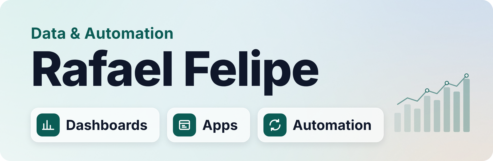

I turn operational data into decisions and repetitive work into automated flows. Today I do this in **Continuous Improvement at DHL Supply Chain**, building the whole solution for automotive logistics teams in Brazil: the data model, the dashboard, the app people use every day and the automation that removes the manual work.

**Open to remote roles with international teams.**

---

### ⭐ Featured project

**[Procurement KPI Dashboard](https://github.com/devRafaelFelipe/procurement-kpi-dashboard)**: a one-page Power BI report that shows a sourcing team where its savings come from, where money is being left on the table and what to do next.

    

**[Read the case study →](https://github.com/devRafaelFelipe/procurement-kpi-dashboard#readme)**

---

### 🛠️ What I build at work

Internal solutions in production. The code is private, so public versions with fictional data are on the way. 
🏆 Kaizen award = recognised by the company's continuous improvement programme.

**🏆 Sourcing dashboard** · *Kaizen award* 
Tracks every sourcing request and its status for the team. Replaced a manual report and now takes **90% less time** to produce. 
`Power BI` `DAX` `HTML`

**🏆 IT asset validation tool** · *Kaizen award* 
Managers physically check notebooks and desktops against the register. Replaced spreadsheet checks that left no audit trail. 
`HTML/JS` `Python` `fuzzy matching` `Puppeteer`

**🏆 Transport cost RPA** · *Kaizen award* 
Fills transport cost fields across plants in a web system automatically. Replaced repetitive manual data entry. 
`Python` `Playwright`

**Project tracking system** 
An app where project managers update their projects, feeding a live dashboard. Replaced status decks assembled by hand in PowerPoint, project by project. 
`Power Apps` `SharePoint Lists` `Power BI`

**Presentation generators** 
Governance and readiness decks built automatically from the team's Excel bases. Replaced pasting chart screenshots into PowerPoint by hand. 
`Python` `Node.js` `pptxgenjs`

**Freight audit tool** 
Flags invoice divergences and anomalies for a team of five auditors. Replaced line-by-line checking in spreadsheets. 
`HTML/JS` `Python`

---

### 🧰 Toolkit

**BI & analytics** 
     

**Automation** 
     

**Apps & web** 
    

**Languages**: Portuguese (native) · English (professional) · Spanish (intermediate)

---

### 📫 Let's talk

Open to remote BI and automation roles with international teams.

📍 Minas Gerais, Brazil · UTC−3
